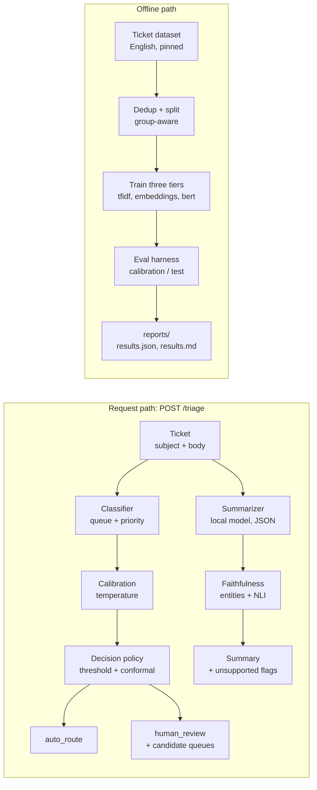

# support-ticket-intelligence

Support ticket routing that knows when to hand off to a human, with calibrated
confidence and summaries checked against the source.


A misrouted ticket is a slow ticket: it waits in the wrong queue before anyone
notices. The obvious fix is a classifier, but a classifier that is confidently
wrong is worse than none, because nobody checks it. This repository routes
support tickets to a queue, estimates priority, and decides per ticket whether
it is confident enough to act alone or should hand the ticket to a person with
its candidate queues attached. It also writes a structured summary and measures
how much of that summary the original ticket actually supports.

The headline numbers, measured once on a held-out test split with the model and
the thresholds frozen beforehand: tickets routed automatically are wrong
**3.3%** of the time, but only **7.7%** of tickets clear that bar; the conformal
prediction sets cover the true queue **89.8%** of the time against a 90% target;
and **0%** of the summaries the summarizer produced introduce a number, address
or identifier that is absent from the ticket. That 7.7% automatic coverage badly misses its 60%
target, and is reported as measured rather than tuned away — see
[reports/results.md](reports/results.md) for the full picture, including the
error-versus-coverage trade-off and what did not work.

This is a personal project built on public data, with no connection to any
employer.

## Architecture



The classifier, calibration, policy and faithfulness modules are shared
libraries: the API and the evaluation harness call exactly the same code.
[docs/architecture.md](docs/architecture.md) walks through both paths.

## Installation for users

With Docker, which brings up the API, the local summarization model and the
console together:

```bash
docker compose up -d --wait
```

Then open the console at <http://localhost:8501>, paste a ticket or pick one of
the built-in examples, and press Triage. A clear ticket is routed
automatically; an ambiguous one comes back as `human_review` with its candidate
queues listed.

The API is at <http://localhost:8000>:

```bash
curl -X POST http://localhost:8000/triage \
  -H 'Content-Type: application/json' \
  -d '{"subject": "Double charged", "body": "My subscription was billed twice."}'
```

Without Docker you need [uv](https://docs.astral.sh/uv/) and a local
[Ollama](https://ollama.com/) for summaries:

```bash
uv sync --extra service
ollama pull qwen2.5:3b-instruct
uv run uvicorn ticketintel.service.api:app --port 8000
uv run streamlit run src/ticketintel/ui/app.py
```

Summarization is optional. If Ollama is not running, triage still answers and
the response carries a `summary_error` instead of a summary.

## Installation for developers

```bash
uv sync --extra dev --extra data   # add --extra ml for the transformer tier
uv run pre-commit install
```

Makefile targets:

| target | what it does |
| --- | --- |
| `make test` | the light unit tests, no heavy dependencies |
| `make test-data` | the tests that need pandas and scikit-learn |
| `make test-ci` | reproduces the light CI job exactly |
| `make cov` | tests with the coverage report |
| `make lint` / `make typecheck` | ruff and mypy strict |
| `make data` | downloads the pinned dataset and writes the data card |
| `make calibrate` | fits the thresholds and freezes `configs/policy.yaml` |
| `make summarize-eval` | summarises the fixed sample and scores faithfulness |

Tests carrying the `ml` marker need torch and transformers and are excluded
from the default run; `pytest -m ml` runs them.

Reproducing the evaluation, in order: `make data`, `make calibrate`, then
`uv run ticketintel evaluate`, which rewrites `reports/results.json`,
`reports/results.md` and the figures.

Layout:

```
configs/      pinned dataset revision, frozen policy, summarizer settings
src/ticketintel/
  data/       loading, cleaning, near-duplicate grouping, splitting
  models/     classifier protocol and the three tiers
  reliability/ calibration, abstention, conformal sets, decision policy
  summarize/  Ollama client, prompt, cache, faithfulness checks
  evaluation/ metrics, ablations, figures, the final evaluation
  service/    the triage API
  ui/         the Streamlit console
docs/decisions/  one ADR per non-obvious decision
reports/      data card, results, figures
```

Every non-obvious decision is written up in `docs/decisions/`, from the choice
of primary metric to why the lighter model was selected over the transformer.

## Contributor expectations

- One branch and one pull request per change; Conventional Commits for the
  messages.
- Tests accompany behaviour changes, and the coverage gate is 85%.
- Any non-obvious decision gets an ADR in `docs/decisions/`.
- Thresholds are fitted on the calibration split only. Nothing is tuned against
  the test split.
- No number reaches a report or this README unless a script in this repository
  produced it.

## Known issues

- **The data is synthetic.** The tickets are generated, not real customer
  correspondence, and they are cleaner and more formulaic than real ones. The
  dataset is licensed `cc-by-nc-4.0`, so it is for non-commercial use.
- **English only.** The source is bilingual; the German half is filtered out.
- **Automatic coverage is low.** Holding auto-route error at 3.3% leaves only
  7.7% of tickets routed automatically. The measured cost of loosening the
  policy to the 60% coverage target is reported in the queue table of
  [reports/results.md](reports/results.md).
- **Calibration misses its target.** ECE is 0.0379 after temperature scaling
  against a 0.03 target.
- **Novelty detection is weak.** Separating the held-out queue by confidence
  gives AUROC 0.5745, far below the 0.75 target. Confidence alone is a poor
  novelty signal here.
- **The conformal guarantee is marginal, not per queue.** Coverage holds on
  average across tickets; it is not guaranteed for any individual queue.
- **The NLI faithfulness number is a floor, not a verdict.** It reads 0.5016,
  but the entailment model produces false negatives on claims the ticket
  supports almost verbatim, and the summarizer genuinely does put topic labels
  in the urgency field. A balanced 60-sentence sample is exported for manual
  adjudication; no claim is made about NLI accuracy until that review exists.
- **One summary in eighteen quotes urgency wording that is not in the ticket.**
  The urgency field is specified as the ticket's own words, and
  `ungrounded_quote_rate` reads 0.0567. This one is measured by word overlap,
  adjacent word pairs and negation agreement rather than by a model, so it is
  a fact about the summaries rather than a judgement about them.
- **Summarization is slow on CPU**, around 2.2 s per ticket at the median and
  3.0 s at the 95th percentile, over 40 timed calls.
