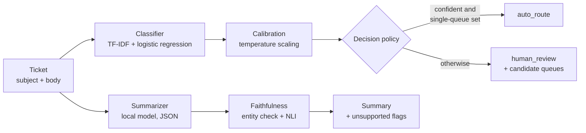
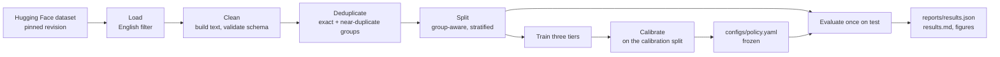

# Architecture

Two paths run through this repository. The request path answers one ticket at a
time and is what the service exposes. The offline path prepares data, trains
and measures, and produces the frozen artefacts the request path loads. They
share the same library code, so a decision rule measured offline is the exact
rule the service applies.

## Request path

`POST /triage` builds the model input the same way training did, as
`subject + "\n" + body`. The classifier returns a probability per queue; the
frozen temperature rescales it; the policy then decides.

The policy auto-routes only when two conditions hold at once: the calibrated
top probability is at or above the abstention threshold, and the conformal
prediction set contains exactly one queue. Anything else goes to a person,
with the candidate queues and the reason attached. The thresholds live in
`configs/policy.yaml` and are never computed at request time.

Summarization is independent of routing. It is requested with
`"summarize": true`, runs against a local model, and is checked in two ways:
deterministically, that every number, email address, URL and identifier in the
summary appears in the ticket; and by entailment, sentence by sentence, with
the ticket as the premise. If the model server is unreachable, the response
still carries the routing decision and reports the summarization failure
explicitly rather than failing the request.

The model and the policy load once at startup. `GET /health` reports whether
both are present, and `GET /metrics` exposes a decision counter by action and a
latency histogram.

## Offline path

Deduplication is the step that makes the rest of the numbers trustworthy. This
dataset is full of near-identical tickets; if one copy lands in training and
another in test, the score flatters the model. Exact duplicates are grouped by
a hash of normalised text, near-duplicates by TF-IDF cosine similarity above a
threshold, and the resulting graph's connected components become groups. A
group is never split across partitions. Measured on this data, a random split
inflates macro-F1 by 0.073 over a group-aware one.

One queue is held out of every training split entirely. It never appears in
training, validation or calibration, which makes it an honest probe for
whether the system can tell that a ticket belongs to something it has not seen.

The thresholds are fitted on the calibration split alone. A test asserts that
the calibration path never reads the test split, because the value of the
final numbers depends on that being true. The test split is evaluated once,
with the model and thresholds already frozen.

## Why the model is TF-IDF

Three tiers were built and compared: TF-IDF with word and character n-grams,
sentence embeddings, and a fine-tuned DistilBERT. On validation the TF-IDF
baseline won both tasks by a wide margin, while being roughly forty times
smaller than the transformer and an order of magnitude faster per ticket. The
selection rule, recorded in `docs/decisions/0005-final-model-selection.md`,
keeps the lighter tier unless a heavier one beats it by at least one macro-F1
point; nothing did. The transformer code remains in the repository as the
measured evidence for that choice.

## Module map

| module | responsibility |
| --- | --- |
| `data/` | load, clean, group near-duplicates, split |
| `models/` | the classifier protocol and the three tiers behind it |
| `reliability/` | calibration, abstention, conformal sets, novelty, policy |
| `summarize/` | model client, prompt, cache, faithfulness checks |
| `evaluation/` | metrics, error analysis, ablations, figures, final run |
| `service/` | the triage API |
| `ui/` | the Streamlit console |

The reliability layer depends only on the classifier protocol, never on a
concrete model, which is why swapping the selected tier would not touch it.
